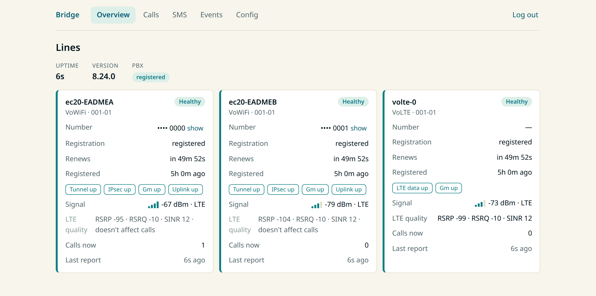
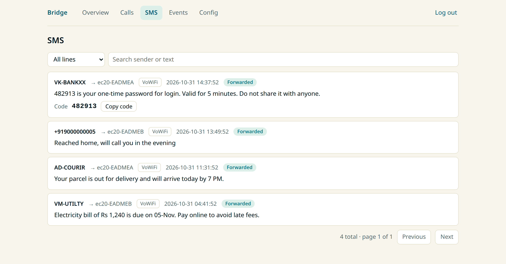

# gsm-sip-bridge

[](https://github.com/selvakn/gsm-sip-bridge/actions/workflows/ci.yml)
[](RELEASE_NOTES.md)
[](LICENSE)

Put a SIM in a box on your network and its calls and texts show up in your
home phone system. Calls to the SIM's number ring your Asterisk or FreePBX
setup, or a SIP phone. Your PBX can also dial out through the SIM.

<!-- TODO(maintainer): one or two lines in your own words: why you built this. -->

<p align="center">
  
</p>

> **Personal and hobby use only.** Cellular-to-VoIP gateways are regulated or
> banned in many countries, and may break your carrier's terms.
> Read the [disclaimer](DISCLAIMER.md) before you plug anything in.

## What you need

- **A Linux machine.** Any x86 box or a Raspberry Pi (arm64).
- **A SIM**, in a Quectel EC20/EC200 modem *or* a plain USB smart-card reader.
  A card reader is enough for Wi-Fi Calling; no modem needed.
- **Something to ring.** A PBX such as Asterisk or FreePBX, or just a
  softphone. The bridge can act as the SIP server itself.

## Three ways a call can arrive

| Path | How it reaches the bridge | Hardware |
|---|---|---|
| **GSM voice** | The modem answers and streams audio over USB | Quectel EC20 |
| **VoWiFi** | An IPsec tunnel to the carrier over your own internet connection | EC20, EC200, or a USB card reader |
| **VoLTE** | IMS over the modem's LTE data connection | EC20 or EC200 |

The carrier decides which path a call takes, and you can enable any mix of
them. VoWiFi and VoLTE run one line per SIM, so several numbers can share one
bridge. [Supported hardware](docs/supported-hardware.md) has the details and
the one-time modem setup.

## What you get

<p align="center">
  <picture>
    <source media="(prefers-color-scheme: dark)" srcset="screenshots/webui-overview-dark.png">
    
  </picture>
</p>

- **Calls in both directions.** Inbound calls are answered and handed to your
  PBX with the caller's number. Outbound calling is opt-in.
- **HD voice over VoWiFi.** Wideband audio (AMR-WB in, G.722 out) stays
  wideband end to end.
- **SMS** on every path, stored locally and optionally posted to Discord.
- **A read-only web UI** for line health, call history and messages. It also
  shows one-time codes with a copy button.
- **Alerts** to Discord when a line drops or recovers, plus Prometheus
  metrics and a Grafana dashboard.
- **Recovers by itself** from USB disconnects, lost registrations and stuck
  modems.

<details>
<summary>The SMS page</summary>
<p align="center">
  <picture>
    <source media="(prefers-color-scheme: dark)" srcset="screenshots/webui-sms-dark.png">
    
  </picture>
</p>
</details>

[Everything it does](docs/features.md) is listed in full in the docs.

## Quick start (Docker Compose)

Set up your modem first if you have one (enable USB audio, keep
ModemManager off it): see [supported hardware](docs/supported-hardware.md).

```bash
git clone https://github.com/selvakn/gsm-sip-bridge && cd gsm-sip-bridge/docker
cp ../config.toml.example config.toml   # add your PBX details
echo "SIP_PASSWORD=yourpassword" > .env
docker compose up -d
```

That starts the bridge along with Prometheus, Grafana and a read-only database
browser. The minimum config is the PBX the bridge should register to:

```toml
[sip]
server = "pbx.example.com"
username = "bridge-account"
password = "env:SIP_PASSWORD"
```

Turn on what you need with `[vowifi]`, `[volte]`, `[outbound]` and `[webui]`.
[`sample_configs/`](sample_configs/README.md) has a ready-made config for each
common setup, and the [configuration reference](docs/configuration.md) covers
every key.

## How it works

The bridge doesn't just pass along audio the modem has already decoded. For
VoWiFi it builds the IKEv2 tunnel to the carrier's ePDG itself, authenticates
to the IMS core with the SIM's own AKA keys, and protects SIP with Gm IPsec.
For VoLTE it does the same over the modem's LTE data connection, bypassing
the modem's own voice stack. It speaks SIP and RTP itself, transcoding AMR-WB
to G.722 between the two legs.

It's written in Rust. FFI is kept to two small crates, for PJSIP and the AMR
codecs. [Architecture](docs/architecture.md) walks through the call flows, the
audio pipeline and the per-line network namespaces.

<details>
<summary>More documentation</summary>

| | |
|---|---|
| **Set up** | [Supported hardware](docs/supported-hardware.md) · [Configuration](docs/configuration.md) · [Sample configs](sample_configs/README.md) |
| **Run** | [Operations and troubleshooting](docs/operations.md) · [Metrics and dashboards](docs/observability.md) |
| **Understand** | [Architecture](docs/architecture.md) · [VoWiFi bridge](docs/vowifi-bridge.md) · [Card-reader VoWiFi](docs/omnikey-pcsc-vowifi.md) · [Host-side VoLTE](docs/operations.md#host-side-ims-over-lte-volte) |
| **Build** | [Building from source](docs/development.md) · [Migrating from v4.1.x](docs/migrating-from-v4.1.x.md) |

[docs/README.md](docs/README.md) is the full index. `docs/` is also mirrored to
the wiki.
</details>

## Community

Questions, setups to show off, and ideas go in
[Discussions](https://github.com/selvakn/gsm-sip-bridge/discussions). Bugs go
in [Issues](https://github.com/selvakn/gsm-sip-bridge/issues). Support is
volunteer and best-effort.

## Acknowledgements

The VoWiFi bridge builds on work by the [Osmocom](https://osmocom.org/)
project: their
[VoWiFi with Asterisk](https://osmocom.org/projects/foss-ims-client/wiki/VoWiFi_with_Asterisk)
research, the `strongswan-epdg` fork, and sysmocom's VoLTE/Gm-IPsec Asterisk
patches mapped out the ePDG, IMS-AKA and Gm IPsec ground this project stands
on. Thank you.

---

GPL-3.0. Not affiliated with Quectel, Sangoma, FreePBX or any carrier.
See the [disclaimer](DISCLAIMER.md).
